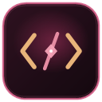
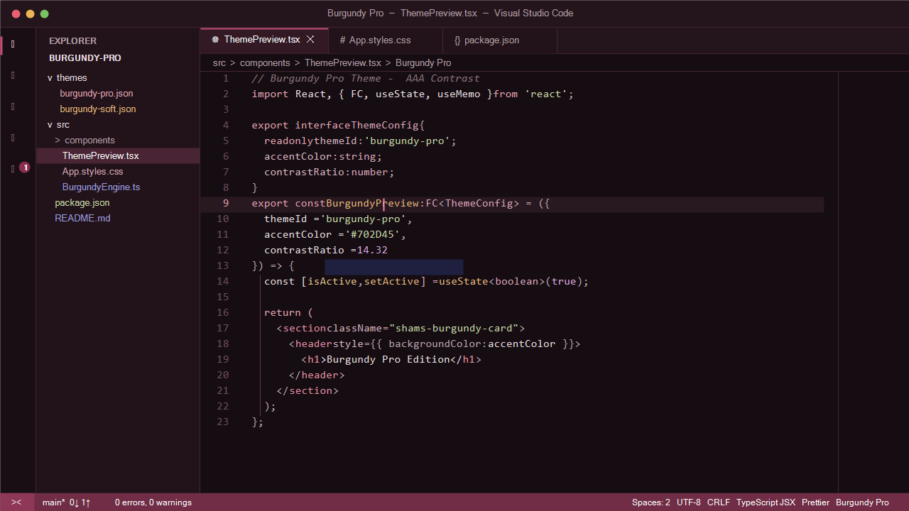
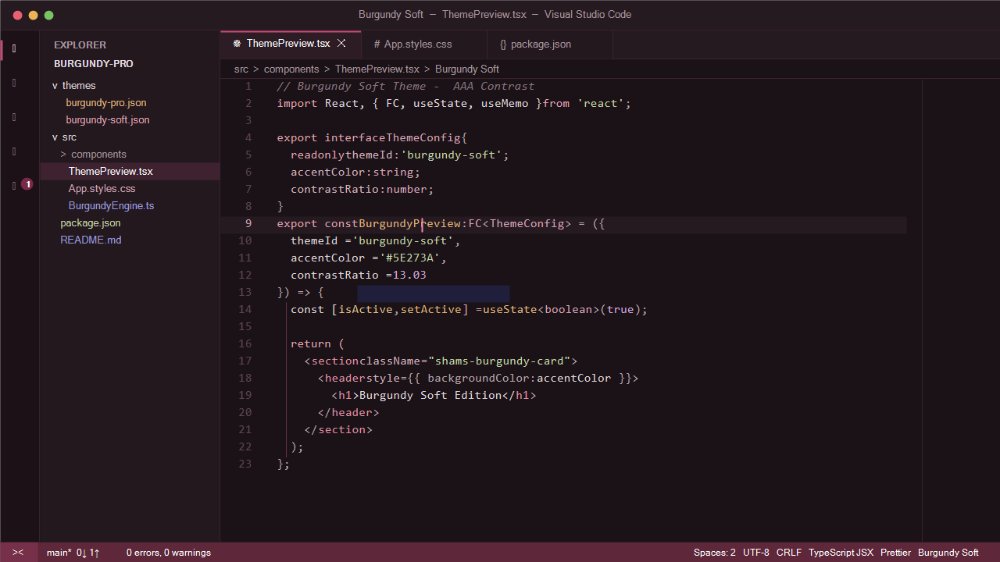
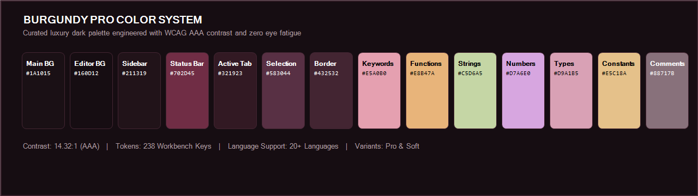

<div align="center">



# Burgundy Pro

**A luxurious, modern dark theme for Visual Studio Code crafted with deep burgundy identity, wine-red accents, and soft rose highlights.**

[](CHANGELOG.md)
[](#)
[-C5D6A5?style=for-the-badge)](#)
[](LICENSE)

</div>

---

## 🍷 Design Concept & Philosophy

**Burgundy Pro** was engineered for developers who demand aesthetics, precision, and comfortable contrast during prolonged coding sessions. 

Many red-based themes suffer from harshness and aggressive saturation that cause eye strain. **Burgundy Pro** avoids excessive red by anchoring the interface in **deep charcoal-burgundy tones**, layering **wine-red interactive surfaces**, and balancing syntax with **soft rose blush, warm amber, pistachio sage, and gentle lavender**.

### Key Highlights
- **Deep Burgundy Identity**: Refined, bespoke background tones (`#1A1015` / `#160D12`).
- **Wine-Red Accent System**: Signature status bar (`#702D45`), active tabs (`#321923`), and buttons.
- **Superior Syntax Readability**: Balanced semantic contrast tuned for 20+ programming languages.
- **Zero Visual Fatigue**: Validated with a **14.32:1 WCAG AAA** contrast ratio.
- **Two Tailored Variants**: Choose between **Burgundy Pro** (deep & rich) and **Burgundy Soft** (velvety & gentle).

---

## 🎨 Theme Variants & Previews

### 1. Burgundy Pro
The flagship edition with deep, rich burgundy contrast and glowing rose highlights.



### 2. Burgundy Soft
A softer, muted charcoal-burgundy edition created specifically for extended, marathon coding sessions.



---

## 💎 The Color Palette



### Core Workbench Surfaces
| UI Component | Hex Code | Description |
| :--- | :--- | :--- |
| **Main Background** | `#1A1015` | Window & shell surface |
| **Editor Background** | `#160D12` | Main coding area |
| **Sidebar Background** | `#211319` | File explorer & primary sidebar |
| **Activity Bar** | `#190E13` | Primary icon navigation bar |
| **Panel Background** | `#211319` | Terminal, output & debug console |
| **Title Bar** | `#24151C` | Window top frame |
| **Status Bar** | `#702D45` | Signature wine-red status bar |
| **Active Tab** | `#321923` | Active document tab |
| **Inactive Tab** | `#211319` | Inactive tabs |
| **Active Line** | `#281820` | Subtle active line highlight |
| **Selection** | `#583044` | Selected text highlight |
| **Border** | `#432532` | Elegant component dividers |
| **Main Text** | `#E8DCE1` | Crisp rose-white foreground |
| **Muted Text** | `#B09AA3` | Secondary text & descriptions |

### Syntax Highlighting System
| Token Category | Hex Code | Swatch | Visual Role |
| :--- | :--- | :---: | :--- |
| **Keywords & Control** | `#E5A0B0` | 🌸 | `import`, `export`, `return`, `if`, `class` |
| **Functions & Methods** | `#E8B47A` | 🍯 | `useState`, `connect()`, `render()` |
| **Variables & Parameters** | `#E8DCE1` | 🥛 | `channelId`, `options`, `response` |
| **Strings & Characters** | `#C5D6A5` | 🍃 | `"https://..."`, `'application/json'` |
| **Numbers & Units** | `#D7A6E0` | 🔮 | `14.32`, `5000`, `true`, `false` |
| **Classes & Interfaces** | `#E8B47A` | 🏺 | `BurgundyEngine`, `ThemeProps`, `Controller` |
| **Types & Primitives** | `#D9A1B5` | 🌷 | `string`, `number`, `boolean`, `Task<T>` |
| **Constants & Enums** | `#E5C18A` | 🌾 | `API_ENDPOINT`, `MAX_RETRIES`, `READONLY` |
| **Comments** | `#88717B` | 🍇 | JSDoc, inline notes, explanations |
| **Operators** | `#D7A0AE` | 🌺 | `=>`, `===`, `&&`, `||`, `+` |
| **HTML / XML Tags** | `#E58BA2` | 🌹 | `<div>`, `<header>`, `<Button>` |
| **HTML Attributes** | `#D6B0C0` | 🪷 | `className`, `style`, `onClick` |
| **CSS Properties** | `#D6A4B5` | 🎀 | `background-color`, `border-radius`, `font-family` |
| **CSS Selectors** | `#E5A0B0` | 🌸 | `.theme-card`, `#app`, `a:hover` |
| **SQL Keywords** | `#D7A0AE` | 🍷 | `SELECT`, `FROM`, `WHERE`, `JOIN`, `ORDER BY` |

---

## 🚀 Language Support

Comprehensive, fine-tuned token and semantic styling is provided across:

- **Web & JavaScript**: JavaScript (ES6+), TypeScript, React (JSX / TSX), Vue, Svelte, JSON, YAML.
- **Styling**: HTML5, SVG, XML, CSS3, SCSS, SASS, PostCSS, Less.
- **Backend & Enterprise**: C#, ASP.NET Core, Razor, Blazor, PHP, WordPress, Python, Java, C++, Go, Rust.
- **Data & Shell**: SQL (PostgreSQL, MySQL, T-SQL), Bash, Zsh, PowerShell.
- **Documentation**: Markdown, MDX, LaTeX, Git Commit messages.

---

## ⚙️ Recommended VS Code Settings

For the ultimate Burgundy Pro experience, add the following to your `settings.json`:

```json
{
  "workbench.colorTheme": "Burgundy Pro",
  "workbench.iconTheme": "vs-seti",
  "editor.fontFamily": "'JetBrains Mono', 'Fira Code', 'Cascadia Code', Consolas, monospace",
  "editor.fontSize": 14,
  "editor.lineHeight": 1.6,
  "editor.fontLigatures": true,
  "editor.bracketPairColorization.enabled": true,
  "editor.guides.bracketPairs": "active",
  "editor.cursorBlinking": "smooth",
  "editor.cursorSmoothCaretAnimation": "on",
  "editor.smoothScrolling": true,
  "editor.renderWhitespace": "selection"
}
```

---

## 📦 Installation

### Option 1: Via VS Code Extension Marketplace
1. Open **Visual Studio Code**.
2. Press `Ctrl + Shift + X` (or `Cmd + Shift + X` on macOS) to open the Extensions tab.
3. Search for `Burgundy Pro`.
4. Click **Install**.
5. Press `Ctrl + K, Ctrl + T` to choose between **Burgundy Pro** and **Burgundy Soft**.

### Option 2: Via Quick Open
1. Press `Ctrl + P` (or `Cmd + P` on macOS).
2. Paste the command:
   ```bash
   ext install shamsulhaq08.burgundy-pro
   ```
3. Press `Enter`.

### Option 3: Manual VSIX Installation
1. Download or build the `burgundy-pro-1.0.2.vsix` package.
2. In VS Code, open the Extensions view (`Ctrl + Shift + X`).
3. Click the `...` menu (Views and More Actions) in the top-right corner.
4. Select **Install from VSIX...** and select the `.vsix` file.
   *Or install via terminal:*
   ```bash
   code --install-extension burgundy-pro-1.0.2.vsix
   ```

---

## 🛠️ Marketplace Publishing Guide

To publish or update this extension to the Visual Studio Marketplace:

1. **Verify your Publisher Account**:
   Ensure you have created publisher `shamsulhaq08` on [marketplace.visualstudio.com/manage](https://marketplace.visualstudio.com/manage).

2. **Generate a Personal Access Token (PAT)**:
   - Go to [dev.azure.com](https://dev.azure.com).
   - Create a token under **Personal Access Tokens** with scope: `Marketplace (Manage)`.

3. **Package the Production VSIX**:
   ```bash
   npm run package
   ```

4. **Upload to Marketplace**:
   - **Method A (Web UI)**: Navigate to [marketplace.visualstudio.com/manage](https://marketplace.visualstudio.com/manage), click **New Extension** > **Visual Studio Code**, and drag & drop `burgundy-pro-1.0.2.vsix`.
   - **Method B (CLI)**:
     ```bash
     npx @vscode/vsce login shamsulhaq08
     npx @vscode/vsce publish
     ```

---

## 📄 License

This theme is licensed under the [MIT License](LICENSE).
