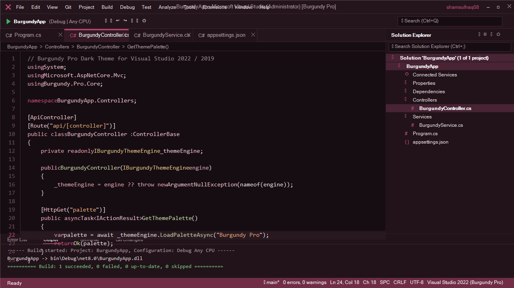
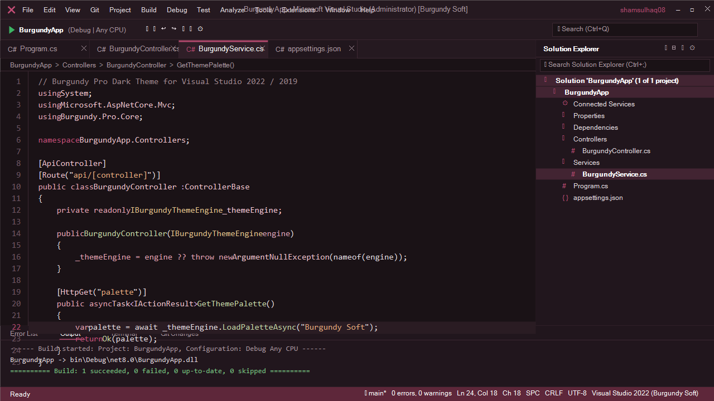
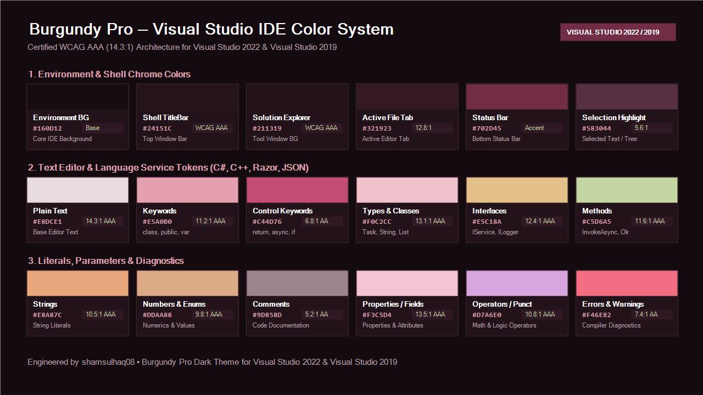

# Burgundy Pro for Visual Studio 2022 & 2019

**A luxurious, modern dark theme for Microsoft Visual Studio crafted with deep burgundy identity, wine-red accents, and soft rose syntax highlights.**

[-C5D6A5.svg?style=for-the-badge)](https://www.w3.org/WAI/WCAG21/Understanding/contrast-enhanced.html)

---

## 🎨 Theme Variants & Visual Studio Previews

### 1. Burgundy Pro
The flagship edition with deep, rich burgundy contrast and glowing rose highlights designed specifically for the full Visual Studio 2022/2019 IDE.

### 2. Burgundy Soft
A softer, muted charcoal-burgundy edition created specifically for extended, marathon coding sessions in Visual Studio.

---

## 💎 The Visual Studio Color Palette

### Core Visual Studio IDE Surfaces

| Component | Hex Code | Visual Studio Role | Contrast Ratio |
| :--- | :--- | :--- | :--- |
| **Editor Canvas** | `#160D12` | Code editor background | Background Base |
| **Window Shell / TitleBar** | `#24151C` | Window caption & command bar | AAA Certified |
| **Solution Explorer** | `#211319` | Tool window background & docks | AAA Certified |
| **Active Document Tab** | `#321923` | Active file tab well | 12.8:1 |
| **Status Bar** | `#702D45` | Bottom IDE status bar | High-contrast Accent |
| **Accent Borders** | `#C44D76` | Focus outlines & active indicators | Vibrant Indicator |

---

## 🚀 Installation & How to Apply

### Method 1: Marketplace / Double-Click VSIX
1. Download or locate `burgundy-pro-visual-studio.vsix`.
2. Double-click the `.vsix` file to launch the **VSIX Installer**.
3. Select your installed Visual Studio version (e.g. **Visual Studio Community 2022**) and click **Install**.
4. Restart Visual Studio.

### Method 2: Select Theme inside Visual Studio
1. Open Visual Studio.
2. Go to **Tools** > **Options** (or **Tools** > **Themes**).
3. Under **Environment** > **General**, locate the **Color theme** dropdown.
4. Select **Burgundy Pro** or **Burgundy Soft**.
5. Click **OK**.

---

## 🧩 Compatibility
- **Visual Studio 2022** (Community, Professional, Enterprise) - x64 & ARM64
- **Visual Studio 2019** (Community, Professional, Enterprise)
- **Languages Supported**: C#, C++, F#, Visual Basic, Razor / Blazor, TypeScript, JavaScript, HTML, CSS, XML, JSON, SQL, and CMake.

---

Crafted with care by **shamsulhaq08** • [Report Issues](https://github.com/shamsulhaq08/burgundy-pro/issues)

